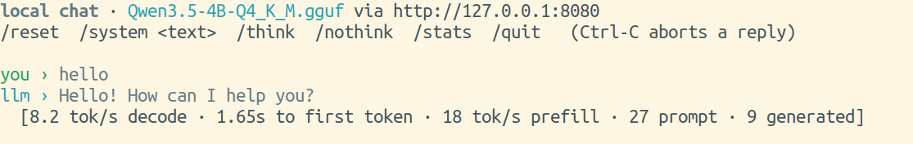

# Local inference on the X1 Carbon

Local LLM serving tuned for this machine (ThinkPad X1 Carbon Gen 11, i7-1365U,
31 GiB LPDDR5, no discrete GPU).

```
llamacpp/llama-b10785/     prebuilt llama.cpp binaries (CPU build)
models/                    GGUF weights
serve.sh                   start llama-server with the tuned flags
chat.py                    interactive streaming client with per-turn timings
```

## Setup

`llamacpp/` and `models/` are not in git (binaries and ~32 GB of weights).
Recreate them from a fresh clone with the steps below. Everything is plain
`curl`; `-C -` resumes a download that was interrupted.

### 1. llama.cpp (build b10785)

`serve.sh` expects the binaries in `llamacpp/llama-b10785/`. Use the Vulkan
build: it contains the CPU backends too, and `VULKAN=1 ./serve.sh` needs its
`libggml-vulkan.so`.

```bash
mkdir -p llamacpp && cd llamacpp
curl -L -C - -O https://github.com/ggml-org/llama.cpp/releases/download/b10785/llama-b10785-bin-ubuntu-vulkan-x64.tar.gz
tar xzf llama-b10785-bin-ubuntu-vulkan-x64.tar.gz   # unpacks to llama-b10785/
cd ..
```

The CPU-only build (`llama-b10785-bin-ubuntu-x64.tar.gz`, same URL path) also
works if you don't need the iGPU. Vulkan offload needs the system Vulkan loader
and Intel driver (`sudo apt install libvulkan1 mesa-vulkan-drivers`).

### 2. Models

Only the first model is required. It is the default in `serve.sh`. Some files
are renamed on download, because the upstream repos all call their vision
projector `mmproj-F16.gguf`.

```bash
mkdir -p models && cd models
HF=https://huggingface.co

# Default chat model - Qwen3.5 4B, Q4_K_M (2.7 GB)
curl -L -C - -o Qwen3.5-4B-Q4_K_M.gguf       $HF/unsloth/Qwen3.5-4B-GGUF/resolve/main/Qwen3.5-4B-Q4_K_M.gguf
curl -L -C - -o mmproj-Qwen3.5-4B-F16.gguf   $HF/unsloth/Qwen3.5-4B-GGUF/resolve/main/mmproj-F16.gguf

# Optional - Qwen3.5 27B, IQ4_XS (15 GB, slow on this machine)
curl -L -C - -o Qwen3.5-27B-IQ4_XS.gguf      $HF/unsloth/Qwen3.5-27B-GGUF/resolve/main/Qwen3.5-27B-IQ4_XS.gguf
curl -L -C - -o mmproj-Qwen3.5-27B-F16.gguf  $HF/unsloth/Qwen3.5-27B-GGUF/resolve/main/mmproj-F16.gguf

# Optional - Gemma 4 E4B, Q4_0 (4.6 GB) + vision projector (Q8_0 or BF16)
curl -L -C - -O $HF/ggml-org/gemma-4-E4B-it-GGUF/resolve/main/gemma-4-E4B-it-Q4_0.gguf
curl -L -C - -O $HF/ggml-org/gemma-4-E4B-it-GGUF/resolve/main/mmproj-gemma-4-E4B-it-Q8_0.gguf
curl -L -C - -O $HF/ggml-org/gemma-4-E4B-it-GGUF/resolve/main/mmproj-gemma-4-E4B-it-BF16.gguf

# Optional - DeepSeek-Coder-V2-Lite, IQ4_XS (8.6 GB MoE, coding)
curl -L -C - -o DeepSeek-Coder-V2-Lite-IQ4_XS.gguf \
  $HF/bartowski/DeepSeek-Coder-V2-Lite-Instruct-GGUF/resolve/main/DeepSeek-Coder-V2-Lite-Instruct-IQ4_XS.gguf
cd ..
```

| File | Size (bytes) | Source repo |
|---|---:|---|
| `Qwen3.5-4B-Q4_K_M.gguf` | 2,740,937,888 | `unsloth/Qwen3.5-4B-GGUF` |
| `mmproj-Qwen3.5-4B-F16.gguf` | 672,423,616 | `unsloth/Qwen3.5-4B-GGUF` |
| `Qwen3.5-27B-IQ4_XS.gguf` | 14,977,484,704 | `unsloth/Qwen3.5-27B-GGUF` |
| `mmproj-Qwen3.5-27B-F16.gguf` | 927,607,040 | `unsloth/Qwen3.5-27B-GGUF` |
| `gemma-4-E4B-it-Q4_0.gguf` | 4,590,807,392 | `ggml-org/gemma-4-E4B-it-GGUF` |
| `mmproj-gemma-4-E4B-it-Q8_0.gguf` | 559,874,816 | `ggml-org/gemma-4-E4B-it-GGUF` |
| `mmproj-gemma-4-E4B-it-BF16.gguf` | 991,552,256 | `ggml-org/gemma-4-E4B-it-GGUF` |
| `DeepSeek-Coder-V2-Lite-IQ4_XS.gguf` | 8,571,593,472 | `bartowski/DeepSeek-Coder-V2-Lite-Instruct-GGUF` |

Check a download with `stat -c '%s %n' models/*.gguf`. The sizes should match
the table exactly. A shorter file means the download was cut off, so re-run the
same `curl` line to resume it.

To give a model image input, pass its projector through to llama-server:

```bash
./serve.sh --mmproj models/mmproj-Qwen3.5-4B-F16.gguf
```

## Use

Two terminals.

```bash
./serve.sh          # terminal 1 - loads the model, holds it in RAM
./chat.py           # terminal 2 - type prompts, watch tokens stream
```



There is also a browser UI at <http://localhost:8080> and an OpenAI-compatible
API at `http://localhost:8080/v1`, so any client that speaks that protocol works
unchanged:

```bash
curl -s localhost:8080/v1/chat/completions \
  -H 'Content-Type: application/json' \
  -d '{"messages":[{"role":"user","content":"hello"}]}' | jq -r '.choices[0].message.content'
```

## Reading the numbers

`chat.py` prints two figures after each reply, and they are bound by different
things:

- **prefill / time to first token** — compute-bound. This is the slow part on a
  15 W chip and it scales with how much you paste in.
- **decode tok/s** — bandwidth-bound. Roughly constant regardless of prompt
  length, and the number the model-size arithmetic predicts.

`/stats` shows the trend across turns. A steady decline is thermal throttling,
not a regression — this package sheds about half its memory bandwidth under
sustained load.

## Swapping models

```bash
MODEL=/path/to/other.gguf ./serve.sh
```

Anything up to ~16 GB fits alongside a normal desktop session. Drop `--mlock`
from `serve.sh` for models above ~8 GB, or it will push everything else into
swap.
